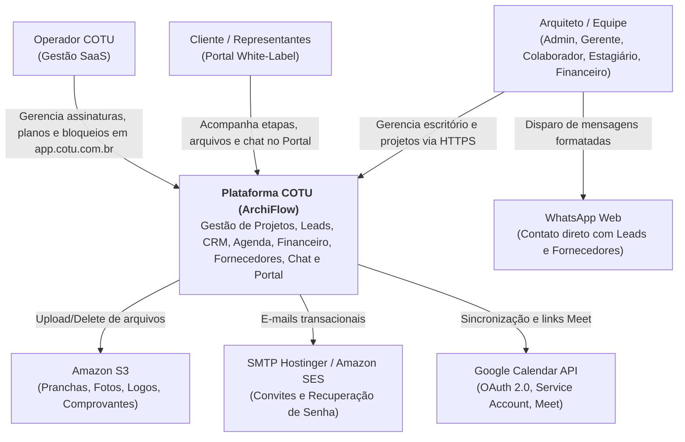
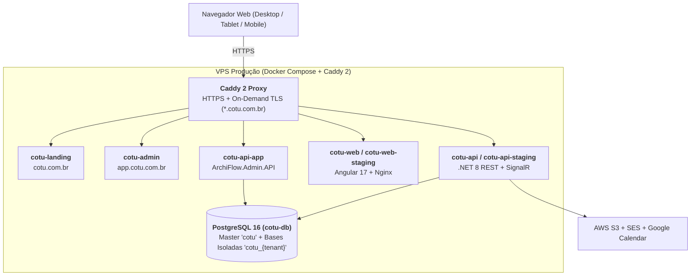

# Arquitetura do Backend — COTU (ArchiFlow)

A API do **COTU (ArchiFlow)** foi projetada sobre os princípios da **Clean Architecture**, combinada ao padrão **Facade**, **Repository + Unit of Work** e arquitetura **Multi-Tenant (Database-per-Tenant)** em **.NET 8**.

---

## 1. Estrutura de Camadas e Dependências

```text
ArchiFlow.sln
├── src/
│   ├── ArchiFlow.Domain/          # Entidades puras, Enums, Roles, ModulosApp, interfaces de repositório e ITenantContext
│   ├── ArchiFlow.Application/     # Commands, DTOs, Services, Facades, AutoMapper e FileSecurityValidator
│   ├── ArchiFlow.Infrastructure/  # ArchiFlowDbContext, DbSeeder, MultiTenancy, Repositories, UnitOfWork, S3/SES/SMTP/Google
│   └── ArchiFlow.API/             # 18 Controllers REST, ChatHub (SignalR), Middlewares, Auth Policies, HealthChecks
└── tests/
    └── ArchiFlow.Tests/           # 84 arquivos de testes unitários e integração (xUnit + FluentAssertions + Moq + Bogus)
```

### Direção das Dependências
- `Domain` não referencia nenhum outro projeto nem bibliotecas externas de infraestrutura.
- `Application` depende apenas de `Domain`.
- `Infrastructure` depende de `Domain` e implementa interfaces definidas em `Domain` e `Application` (sem criar dependência circular).
- `API` orquestra injeção de dependência em [`ServiceCollectionExtensions.cs`](../src/ArchiFlow.API/Extensions/ServiceCollectionExtensions.cs) e expõe endpoints REST + SignalR.

---

## 2. Diagramas de Arquitetura (Modelo C4 Atualizado)

### Nível 1 — Contexto do Sistema



### Nível 2 — Containers em Produção



### Nível 3 — Componentes Internos da API Principal (`ArchiFlow.API`)

```mermaid
flowchart LR
    Req["Requisição HTTPS / WebSocket"] --> Fwd["ForwardedHeaders + CORS Dinâmico"]
    Fwd --> Exc["ExceptionMiddleware + Serilog"]
    Exc --> Auth["JWT Bearer Authentication"]
    Auth --> TenantMW["TenantResolutionMiddleware<br/>(Resolve Tenant + Auto-Provisiona DB)"]
    TenantMW --> Authz["Authorization Policies + RequireModule + ProjetoOwnerHandler"]

    Authz --> Controllers["18 Controllers REST"]
    Authz --> Hub["ChatHub (/hubs/chat)"]

    Controllers --> Facades["Application Facades"]
    Hub --> Facades
    Facades --> Services["Application Services + Validators"]
    Services --> UoW["Repositories + UnitOfWork"]
    UoW --> DbCtx["ArchiFlowDbContext<br/>(ConnectionString por Tenant)"]
    Services --> InfraExt["S3/Local Storage · Email · Google Calendar"]
```



---

## 3. Segurança, Autenticação e Autorização

### 3.1 Autenticação Stateless (JWT) & Senhas
- **Hashing:** `BCrypt.Net` com `workFactor: 12` para senhas de equipe (`Usuarios`), clientes legados (`Clientes`), representantes (`Representantes_Clientes`) e tokens seguros SHA-256 para recuperação de senha e convites.
- **JWT Bearer:** tokens HS256 com `ClockSkew = TimeSpan.Zero`, validando `Issuer`, `Audience`, `Lifetime` e `IssuerSigningKey`.
- **Token no SignalR:** suporte seguro via query string `access_token` restrito ao path `/hubs/chat`.

### 3.2 Controle de Acesso em 3 Camadas
1. **Policies de Papel (Role-Based):**
   - `ApenasAdmin`: `Administrador`, `ArquitetoAdmin`
   - `ApenasGerenteOuAdmin`: `Administrador`, `Gerente`, `ArquitetoAdmin`
   - `AcessoArquiteto`: todos os papéis da equipe (`Administrador`, `Gerente`, `Colaborador`, `ArquitetoAdmin`, `ArquitetoColaborador`, `Estagiario`, `Financeiro`)
2. **Controle Granular por Módulo (`[RequireModule]`):**
   - Verifica a lista `USR_Modulos_Permitidos` (`dashboard`, `leads`, `clientes`, `fornecedores`, `projetos`, `agenda`, `financeiro`, `configuracoes`), impedindo acesso via API mesmo que o usuário tente forçar a URL diretamente.
3. **Autorização Baseada em Recurso (`ProjetoOwnerHandler` + `ChatHub`):**
   - Para usuários do perfil `Cliente`, valida se a claim `cliente_id` ou `projeto_id` realmente pertence ao projeto solicitado, bloqueando acessos horizontais (anti-IDOR) tanto nos endpoints REST (`/api/projetos/{id}`, `/api/arquivos/projeto/{id}`, `/api/mensagens/...`) quanto nas conexões SignalR.

### 3.3 Proteções OWASP Top 10 Aplicadas
- **SQL Injection:** consultas LINQ parametrizadas via EF Core; validação estrita de nome de banco (`^[a-z0-9_]+$`) no `TenantDatabaseProvisioner`.
- **CORS Dinâmico:** allowlist explícita em `AllowedOrigins` estendida automaticamente para subdomínios legítimos do domínio raiz configurado.
- **Swagger Restrito:** `UseSwagger()` e `UseSwaggerUI()` ativos apenas quando `app.Environment.IsDevelopment()` (bloqueado em produção).
- **Validação de Upload:** `FileSecurityValidator` verifica extensão, MIME type e limite de tamanho antes do envio ao S3/storage.
- **Exposição de Erros:** `ExceptionMiddleware` intercepta exceções não tratadas e retorna respostas JSON padronizadas sem stack traces em produção.

---

## 4. Observabilidade, Qualidade e Health Checks

- **Logging Estruturado:** **Serilog** com `UseSerilogRequestLogging()` para rastreabilidade de requisições HTTP e erros.
- **Health Check (`/health`):** executa `DatabaseHealthCheck` contra o PostgreSQL, retornando HTTP `200` (`Healthy`) ou `503` (`Unhealthy`), usado também pelo Caddy (`on_demand_tls`) e pelo pipeline de deploy.
- **Qualidade Contínua:** análise estática automática no **SonarCloud** e **84 suítes de testes automatizados (xUnit)** executadas a cada push/PR contra um PostgreSQL 16 real no GitHub Actions.
