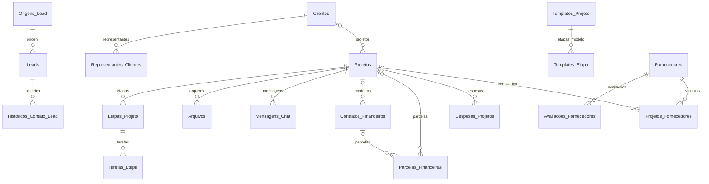

# Modelo de Dados e Estratégia de Migrações

Este documento apresenta a estrutura completa de banco de dados do backend (**25 tabelas por tenant** no [`ArchiFlowDbContext`](../src/ArchiFlow.Infrastructure/Data/ArchiFlowDbContext.cs) + **2 tabelas de governança SaaS** no `AdminDbContext` da `ArchiFlow.Admin.API`), comparando com as **9 tabelas previstas no RFC original**.

---

## 1. Resumo da Evolução de Tabelas (RFC → Entrega Final)

| Grupo / Domínio | Tabelas do RFC (9) | Tabelas Atuais (25 + 2) | O que mudou e por quê |
| :--- | :--- | :--- | :--- |
| **Governança SaaS** *(Master `cotu`)* | *(não existia)* | `Tenants_Assinaturas`, `Usuarios` *(Admin)* | Criadas na `ArchiFlow.Admin.API` para gerenciar planos, mensalidades, status financeiro e bloqueio de tenants. |
| **Usuários, Empresa & Segurança** | *(não existia)* | `Usuarios`, `Tokens_Recuperacao_Senha`, `Dados_Empresa`, `Opcoes_Configuracao` | Suporte a equipe multiusuário com RBAC granular por módulo, recuperação de senha por token hash, White-Label (`Dados_Empresa`) e catálogo de opções. |
| **CRM Comercial** | `Lead`, `Historico_Lead`, `Cliente` | `Origens_Lead`, `Leads`, `Historicos_Contato_Lead`, `Clientes`, `Representantes_Clientes` | Normalização de origens (`Origens_Lead`), motivo de perda no Kanban e suporte a **múltiplos representantes por cliente** com convite por token. |
| **Projetos & Templates** | `Projeto`, `Tarefa`, `Arquivo` | `Projetos`, `Etapas_Projeto`, `Tarefas_Etapa`, `Arquivos`, `Templates_Projeto`, `Templates_Etapa` | Normalização de etapas com ordem e prazos (`Etapas_Projeto`), prazos em tarefas (`TAR_Data_Limite`) e modelos reutilizáveis (`Templates_*`). |
| **Comunicação & UX** | *(não existia)* | `Mensagens_Chat`, `Preferencias_Dashboard` | Chat em tempo real (SignalR) por projeto e personalização dos cards da tela inicial por usuário. |
| **Agenda** | *(fora do escopo)* | `Compromissos_Agenda`, `Configuracoes_Agenda_Escritorio` | Agenda corporativa do escritório integrada ao Google Calendar (OAuth 2.0 / Service Account / Google Meet). |
| **Financeiro** | `Honorario` *(Pós-TCC)* | `Contratos_Financeiros`, `Parcelas_Financeiras`, `Despesas_Projetos` | Antecipado do Pós-TCC com contratos, baixas/comprovantes e despesas operacionais com `ProjetoId` opcional. |
| **Fornecedores** | `Fornecedor`, `Proj_Fornecedor` *(Pós-TCC)* | `Fornecedores`, `Avaliacoes_Fornecedores`, `Projetos_Fornecedores` | Antecipado do Pós-TCC com tabela própria de avaliações 1–5 e cálculo automático de média. |

---

## 2. Diagrama Entidade-Relacionamento (`ArchiFlowDbContext`)

---

## 3. Decisões Técnicas de Persistência no `ArchiFlowDbContext`

1. **Chaves `uuid` (`Guid`):** todas as 25 entidades usam `Guid` como PK, eliminando enumeração sequencial de IDs e facilitando geração no domínio.
2. **Nomenclatura com prefixos:** colunas mapeadas explicitamente com prefixos de 3 letras (`PJT_`, `ETo_`, `TAR_`, `TMP_`, `TME_`, `USR_`, `CLI_`, `REP_`, `TRS_`, `EMP_`, `LED_`, `OL_`, `HCL_`, `ARQ_`, `MSG_`, `PDB_`, `CTF_`, `PAR_`, `DSP_`, `CMP_`, `CAE_`).
3. **Conversão Global UTC (`UtcDateTimeConverter`):** configurada em `ConfigureConventions` para todas as propriedades `DateTime` e `DateTime?`, além de `Npgsql.EnableLegacyTimestampBehavior`, evitando erros de *Kind=Unspecified* no PostgreSQL e desvios de fuso horário na agenda.
4. **`ProjetoId` Opcional no Financeiro e Fornecedores:** `Contratos_Financeiros`, `Parcelas_Financeiras`, `Despesas_Projetos` e `Projetos_Fornecedores` possuem `IsRequired(false)` e `OnDelete(DeleteBehavior.SetNull)`, permitindo despesas gerais do escritório (aluguel, licenças, plotagem geral) e preservando lançamentos financeiros caso um projeto seja excluído.

---

## 4. Estratégia de Migrações e Seeds (`DbSeeder.cs`)

Em um sistema multi-tenant onde novos bancos `cotu_<tenant>` são criados dinamicamente em tempo de execução, não é viável depender de `dotnet ef database update` manual. Por isso, [`DbSeeder.MigrateAndSeedContextAsync`](../src/ArchiFlow.Infrastructure/Data/DbSeeder.cs) executa automaticamente em cada banco:

1. **`await context.Database.MigrateAsync()`:** aplica o histórico de migrations do EF Core.
2. **`await EnsureAdditionalTablesAndColumnsAsync(...)`:** garante de forma idempotente (`CREATE TABLE IF NOT EXISTS`, `ADD COLUMN IF NOT EXISTS`, `CREATE INDEX IF NOT EXISTS`, ajustes de nulabilidade em `CTF_Projeto_Id`, `PAR_Projeto_Id`, `DSP_Projeto_Id`) que bancos já existentes em produção recebam novos esquemas sem perda de dados.
3. **`await SeedAsync(...)`:** semeia de forma idempotente (apenas quando a tabela está vazia):
   - **5 Origens de Lead:** `Instagram`, `Indicação`, `Site`, `E-mail`, `Outros`.
   - **4 Templates de Projeto:** `residencial-completo`, `interiores-reforma`, `comercial-corporativo`, `consultoria-viabilidade`.
   - **Usuário Administrador Inicial:** via `SEED_ADMIN_*` (e usuários `gerente` / `colaborador` apenas quando `isDevelopment == true`).
   - **Dados da Empresa Padrão:** `"COTU Studio"` com cor primária `#765538`.

> Para a descrição detalhada campo a campo e justificativa de negócio de todas as 25+2 tabelas, consulte também [`MODELO_DE_DADOS.md`](https://github.com/GabrielBandoch/ArchiFlow/blob/main/docs/MODELO_DE_DADOS.md) no repositório Frontend.
