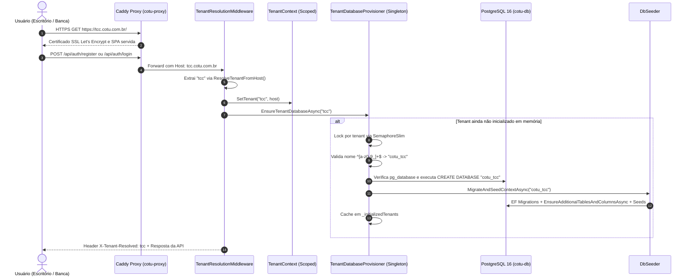

# Multi-Tenancy e Provisionamento Automático de Bases

Esta página documenta a arquitetura **Database-per-Tenant** implementada na `ArchiFlow.API`, explicando como cada escritório cliente recebe seu próprio banco de dados PostgreSQL isolado e como ocorre o ciclo desde o cadastro/pagamento até o primeiro login.

---

## 1. Modelo Escolhido: 1 Banco de Dados por Cliente

Cada subdomínio acessado na plataforma é mapeado para um banco PostgreSQL independente:

| Subdomínio / Origem | `TenantId` Resolvido | Banco PostgreSQL Utilizado |
| :--- | :--- | :--- |
| `localhost` / `api.cotu.com.br` | `default` | `cotu` *(ou valor de `DB_NAME`)* |
| `staging.cotu.com.br` | `staging` | `cotu_staging` |
| `duna.cotu.com.br` | `duna` | `cotu_duna` |
| `tcc.cotu.com.br` | `tcc` | `cotu_tcc` |
| `<novo>.cotu.com.br` | `<novo>` | `cotu_<novo>` |

### Por que Database-per-Tenant?
1. **Isolamento físico:** não há risco de uma query sem filtro `WHERE TenantId = ...` vazar dados de um escritório para outro.
2. **Conformidade LGPD:** exclusão, backup ou auditoria dos dados de um cliente ocorre em nível de banco isolado.
3. **Escalabilidade limpa:** permite migrar um escritório grande para outro servidor PostgreSQL apenas alterando sua string de conexão.

---

## 2. Fluxo Ponta a Ponta (Contratação/Pagamento → Base Pronta)

### 2.1 Gestão Comercial e Assinatura (`ArchiFlow.Landing` + `Tenants_Assinaturas`)
1. O potencial cliente conhece os planos na Landing (`cotu.com.br`) — *Starter*, *Professional* e *Enterprise*.
2. O escritório é registrado pelo serviço interno de faturamento na tabela **`Tenants_Assinaturas`** do banco master `cotu` com subdomínio único, plano, mensalidade e status `Trial`.
3. Quando o pagamento é confirmado, o status passa para `Adimplente`, `TAS_Ultimo_Pagamento` é atualizado, `TAS_Data_Vencimento` avança 1 mês e eventuais bloqueios são removidos.

### 2.2 Provisionamento Automático na Primeira Requisição (`ArchiFlow.API`)

Quando alguém acessa `https://<subdominio>.cotu.com.br/`:

---

## 3. Anatomia dos Componentes no Código

### 3.1 `TenantResolutionMiddleware` (`src/ArchiFlow.API/Middleware/TenantResolutionMiddleware.cs`)
- **Requisições autenticadas:** lê obrigatoriamente a claim `"tenant"` do JWT.
  - Se o header `X-Tenant-Id` vier diferente da claim `"tenant"`, responde **HTTP `403 Forbidden`** (anti-spoofing).
  - Se o subdomínio do `Host` (quando não for `default`) divergir da claim `"tenant"`, também responde **HTTP `403 Forbidden`**.
  - Ignora GUIDs na claim `escritorio_id` para evitar criar bancos com UUIDs.
- **Requisições anônimas (`/api/auth/login`, `/api/auth/register`, `/health`):**
  - Em `Development`/`Testing`, aceita o header `X-Tenant-Id` caso informado.
  - Em produção, resolve exclusivamente pelo `Host` (`ResolveTenantFromHost`). Prefixos de infraestrutura (`www`, `api`) retornam `default`; subdomínios de clientes (`duna.cotu.com.br`, `tcc.cotu.com.br`, `staging.cotu.com.br`) retornam o respectivo identificador.
- Sempre devolve o cabeçalho `X-Tenant-Resolved` na resposta HTTP.

### 3.2 `TenantContext` (`src/ArchiFlow.Infrastructure/MultiTenancy/TenantContext.cs`)
- Serviço `Scoped` que traduz `TenantId` em `DatabaseName`:
  - `"default"` → `cotu` (ou `DB_NAME`)
  - Qualquer outro tenant → `{baseDb}_{tenant.Replace("-", "_")}`
- Utilizado por [`ServiceCollectionExtensions.ConfigureDatabase`](../src/ArchiFlow.API/Extensions/ServiceCollectionExtensions.cs) para montar a `ConnectionString` do `ArchiFlowDbContext` por requisição.

### 3.3 `TenantDatabaseProvisioner` (`src/ArchiFlow.Infrastructure/MultiTenancy/TenantDatabaseProvisioner.cs`)
- Singleton com:
  - `_initializedTenants` (`ConcurrentDictionary<string, bool>`): evita consultas ao PostgreSQL após o primeiro acesso.
  - `_locks` (`ConcurrentDictionary<string, SemaphoreSlim>`): evita *race condition* caso duas requisições cheguem simultaneamente no primeiro acesso a um novo tenant.
  - `ValidarNomeBanco`: garante que o nome gerado corresponda estritamente a `^[a-z0-9_]+$` antes de executar `CREATE DATABASE`.
- Na inicialização da API (`Program.cs`), os tenants padrão `default`, `staging` e `duna` já são verificados e provisionados proativamente.

### 3.4 `ChatHub` (`src/ArchiFlow.API/Hubs/ChatHub.cs`)
- Como conexões WebSocket do SignalR não passam apenas por controllers REST tradicionais, o `ChatHub` executa `EnsureTenantContext()` antes de instanciar o `IMensagemChatFacade`, garantindo que as mensagens em tempo real sejam gravadas no banco correto do tenant.
